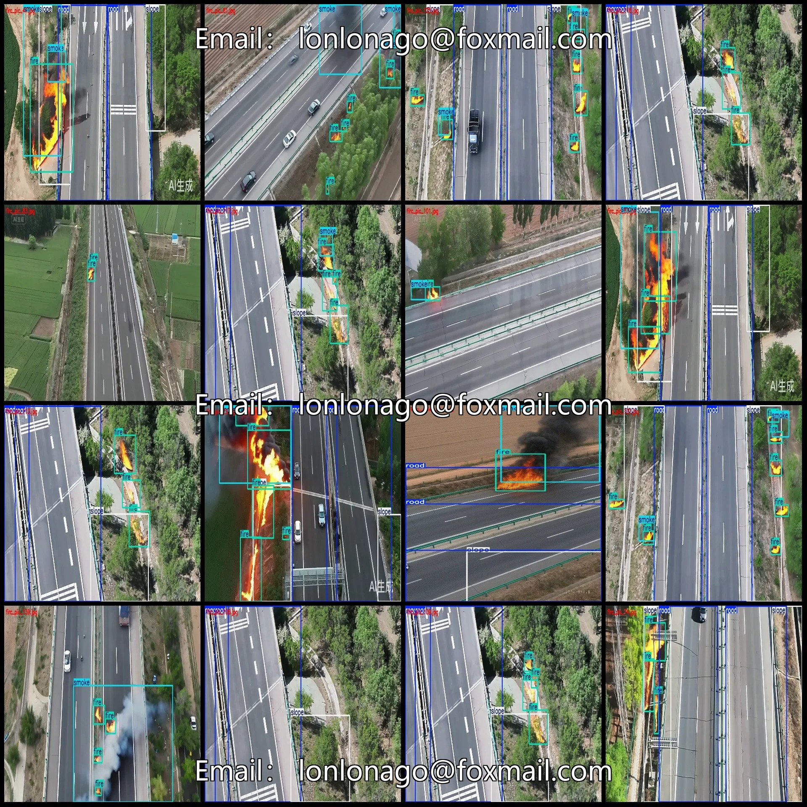
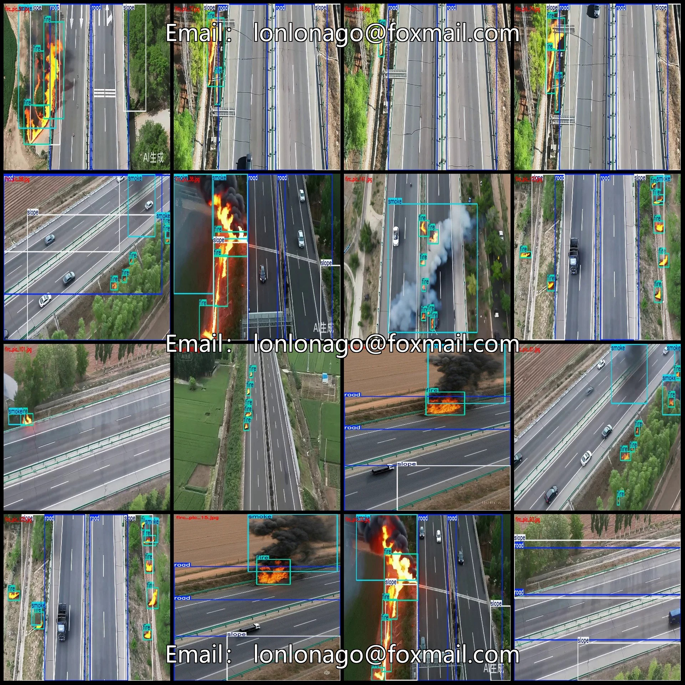
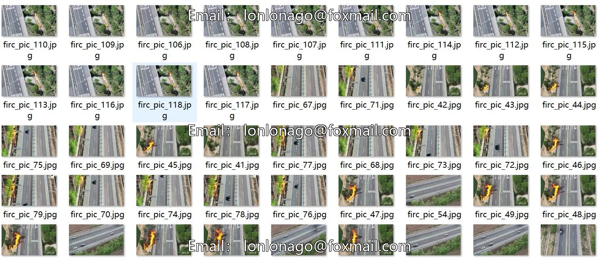
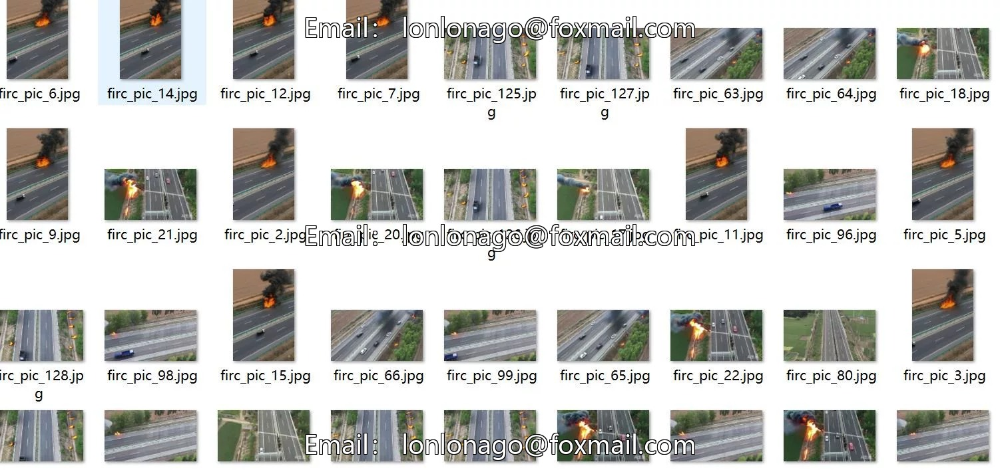

# Drone-view aerial photography dataset for fire detection on highways in VOC+YOLO format

## Body

Drone-View Aerial Photography High-Speed Highway Fire Detection Dataset VOC+YOLO Format: 144 Images, 4 Categories
Warm Reminder: Due to the dataset's replicability, please confirm compliance with requirements before purchasing.
Dataset Format: Pascal VOC format + YOLO format (excluding split paths in txt files, only including jpg images and corresponding VOC format xml files and yolo format txt files)
Number of Images (Total jpg Files): 144
Number of Annotations (Total xml Files): 144
Number of Annotations (Total txt Files): 144
Number of Annotation Categories: 4

Annotation Category Names: ["fire", "road", "slope", "smoke"]
Number of Boxes per Category:
- fire (Flame/Fire) = 441
- road (Road) = 224
- slope (Slope) = 200
- smoke (Smoke) = 127
Total Boxes: 992
Number of Images per Category:
- fire (Flame/Fire) = 129
- road (Road) = 113

Slope (Slope) occupies 112 images
Smoke (Smoke) occupies 89 images
Image resolution: 1248x704
Labeling tool used: labelImg
Labeling rules: Draw a rectangle around the category
Important note: The dataset does not include splits for training, validation, or testing. Please perform your own splitting.
Special statement: This dataset does not guarantee the accuracy of the trained models or weight files.

## Images

## Payment

Here is a pay link on Stripe ( https://buy.stripe.com/3cs8yP7sY87d0vu9AB ). Please contact me lonlonago@foxmail.com after funding $89, and I will send you a complete data files , thank you!

